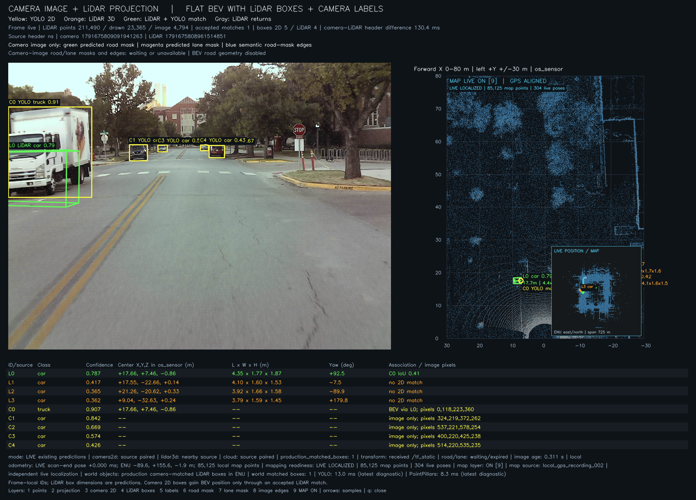
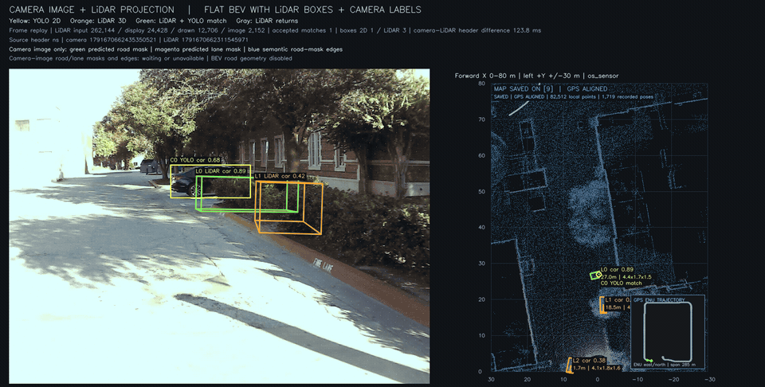

# Camera + LiDAR BEV

A ROS 2 Jazzy/C++ project for one front camera and Ouster LiDAR on NVIDIA AGX Thor, based on the supplied [BEV_README.md](docs/BEV_README.md). It provides recording, camera/LiDAR object BEV, local mapping and experimental localization against a GPS-aligned saved map. The live localized display places the sensor and detected objects on that map; timing and absolute accuracy remain provisional.

## Results



Live physical sensors: camera 2D labels and projected LiDAR 3D predictions beside an **80 m flat BEV**, with the independently estimated live position on a saved map. A subsequent optimized 20-second check maintained **10 FPS**, with the map ready in **200/200 frames**.



Short **1× recording replay** using the original recording's saved trajectory poses for the map overlay. This replay and the live localization snapshot are separate runs; object boxes are model predictions.

See the [visual results gallery](docs/results.md) for the GPS/LiDAR drive comparison, measured processing times and each result's context.

## Record camera + LiDAR test data

For a five-minute sensors-only session with several scenes, position the stationary rig and run:

```bash
cd /home/agxthor/SingleCameraBev/camera_lidar_bev
bash tools/collect_camera_lidar.sh --duration 300 --scene 'multi_scene_test'
```

This records the calibrated native camera and original Ouster scans, without starting detectors or RViz. Calibration/configuration snapshots and bag validation stay with the local recording. Five minutes is approximately 60 GB uncompressed; MCAP uses lossless compression when available. With approximately 31 GiB free on this host at preparation, the full duration may not fit: the collector stops cleanly at a 2 GiB free-space floor. Use `--output` on a larger disk if needed. See [the recording guide](docs/camera_lidar_recording.md) for scene ideas, output paths, validation and unverified sensor timing. Preparing the code does not start a recording.

For dense **10 Hz** scans, stop an existing LiDAR/BEV launcher with Ctrl+C, then run `bash tools/collect_camera_lidar.sh --lidar-mode 2048x10 --duration 300 --scene '10hz_test'`. This uses a separate recording profile and preserves the usual 20 Hz live default.

## Run the live camera + LiDAR BEV

On the configured AGX Thor, close an existing RViz window and run:

```bash
cd /home/agxthor/SingleCameraBev/camera_lidar_bev
bash tools/run_bev.sh --camera-lidar-boxes
```

The wrapper sources ROS 2 Jazzy, the Ouster driver workspace and this project's overlay. It defaults to `ROS_DOMAIN_ID=1` and `DISPLAY=:1`, checks the installed executables and saved engines, and starts or reuses the required sensors and detectors.

The current layout shows:

- The labeled front-camera image beside a black, top-down BEV covering approximately 0–60 m forward.
- Orange LiDAR points inside predicted car boxes and magenta points inside predicted person boxes. These points remain visible independently of camera matching.
- Flat oriented rectangles and length/width/height labels **only for boxes with a camera match**. PointPillars predicts the 3D geometry; YOLO supplies the camera class and its separate confidence.

Keep the rig stationary for this preview. Ctrl+C stops processes started by the wrapper; reused processes continue. Closing RViz leaves the processors running. Use `--no-rviz` to start missing processors without opening another viewer.

The local runtime needs `models/camera_objects_001/yolo11n_fp16_raw.engine` and `models/lidar_objects_001/pointpillar_fp16.plan`, plus the imported native 1024 × 768 camera calibration and candidate B extrinsics. The [camera provenance](models/camera_objects_001/provenance.json) and [LiDAR provenance](models/lidar_objects_001/provenance.json) record the engine builds for the local CUDA/TensorRT environment. Engines are excluded from source control. See [the combined guide](docs/camera_lidar_boxes.md) for setup and [the build instructions below](#build).

## View modes

The combined image/BEV view also includes [camera road/lane segmentation](docs/road_lane_detection.md) and semantic road-mask edges on the camera image. Road-to-BEV geometry and curb processing have been removed. Run `bash tools/replay_combined_bev.sh` to view the saved outdoor recording. Keys `6`–`8` toggle image road masks, lane masks and edges.

For the camera image with LiDAR projections, YOLO 2D boxes and projected LiDAR 3D boxes beside a flat 80 m BEV with object details:

```bash
bash tools/run_bev.sh --combined-view
```

The [combined display guide](docs/combined_bev_display.md) also covers bag replay and browsing the ten cached comparison samples without running models.

The combined display includes raw points to 80 m forward. PointPillars box centers are limited to its trained 69.12 m forward range. Other RViz object modes keep their existing 60 m profiles.

Run `bash tools/run_bev.sh` with one of these display modes:

| Flag | View |
| --- | --- |
| `--camera-lidar-boxes` | Labeled camera, native car/person points and camera-matched learned boxes; current combined view |
| `--combined-view` | Camera 2D labels, LiDAR 3D boxes, road/lane masks, projected LiDAR returns, flat BEV and object details |
| `--lidar-3d-boxes` | LiDAR-only car/person predictions, flat footprints and predicted dimensions |
| `--camera-labels` | Camera labels and boxes around associated visible LiDAR returns |
| `--bev-only` | Ground/obstacle points and camera-associated observed boxes in one flat BEV |
| `--object-points-only` | Camera-associated vehicle/person points |
| `--vehicle-bev-boxes` | Camera-associated points and flat vehicle footprints from observed returns |
| No display flag | Stationary ground/obstacle view and a separate occupancy window |

Observed-return boxes describe the visible points. Learned PointPillars boxes predict full dimensions and yaw. The `--lidar-3d-boxes` and `--camera-lidar-boxes` modes both retain the flat layout. Their enabled LiDAR classes are `car` and `person`; cyclists remain disabled.

Camera-only SMOKE 3D detection has been removed from the active live/replay pipeline and display controls. Its source, models and earlier results remain as an [archived experiment](docs/camera_3d_detection.md).

## If points are visible but boxes are missing

The combined profile requires a compatible camera detection, fresh inputs and sufficient projected overlap. Objects outside the front camera's field of view, missed detections or disagreement between projected LiDAR and camera boxes can leave the BEV without boxes even when the LiDAR is healthy.

The default RViz point display uses `/camera_lidar_bev/lidar_vehicle_points`. The optional **Camera-matched vehicle/person points (toggle)** uses `/camera_lidar_bev/camera_lidar_points`; that filtered topic can be empty when there are no matches. Keep the native point display enabled for context. The box overlay uses `/camera_lidar_bev/camera_lidar_markers` and retains `require_camera_match: true` in the [fusion profile](config/perception/camera_lidar_boxes.yaml).

Association currently requires camera confidence ≥ 0.35, projected image-box IoU ≥ 0.20, compatible classes and camera/LiDAR header differences ≤ 0.15 s. Inputs expire after 0.5 s. The [combined guide](docs/camera_lidar_boxes.md) describes the remaining checks and diagnostics.

If startup reports a DDS socket receive-buffer error, install the host settings once so they survive reboot:

```bash
sudo bash tools/setup_dds_transport.sh
```

Then rerun the launcher. The helper applies only `/etc/sysctl.d/90-camera-lidar-bev.conf` and retains larger existing buffer limits. The launcher checks these prerequisites and does not run sudo itself; see [LiDAR bring-up](docs/lidar_bringup.md).

## Measured performance and validation

The [latest 10-second live observation](evaluation/camera_lidar_boxes_live_002.json) measured approximately **20 Hz** for raw LiDAR scans, both detectors, the labeled camera image and combined output updates. The Ouster runs in `1024x20` mode with 131,072 returns per scan; the camera captures native 1024 × 768 images at a requested 30 FPS.

| Stage | Median processing time | Median inference time |
| --- | --- | --- |
| LiDAR detector node | 10.1 ms | 5.39 ms |
| Camera detector, before publication | 11.0 ms | 1.91 ms |
| Camera/LiDAR association | 0.34 ms | — |

The observed scene contained 3–6 LiDAR car predictions per scan and camera car/truck labels, with zero accepted camera matches. Native points remained visible while matched outputs were empty. A 20 Hz output rate therefore does not imply 20 successful associations per second. No live person detection was observed in this measurement.

The native detector [replay](evaluation/lidar_vehicle_detector_replay_004.json) passed 14/14 checks, including trained pedestrian inference on a KITTI reference scan. Association replays passed 23/23 checks in both [retain-unmatched mode](evaluation/camera_lidar_boxes_replay_002.json) and [require-camera-match mode](evaluation/camera_lidar_boxes_replay_003.json). These verify software behavior and geometry preservation. Physical Ouster detection, dimensions and camera association accuracy remain unvalidated; the short timing sample does not establish sustained or worst-case performance.

## Build

Use the installed ROS 2 Jazzy and JetPack-compatible CUDA/TensorRT environment:

```bash
cd /home/agxthor/SingleCameraBev/camera_lidar_bev
source /opt/ros/jazzy/setup.bash
source /home/agxthor/sensors_ws/install/setup.bash
export PATH=/usr/local/cuda/bin:$PATH
colcon build --base-paths src --packages-up-to bev_bringup --symlink-install --cmake-args \
  -DPython3_EXECUTABLE=/usr/bin/python3 -DCMAKE_BUILD_TYPE=Release
```

Building the packages does not generate the model engines. See [camera object detection](docs/camera_objects.md), [LiDAR detection](docs/lidar_vehicle_detection.md), [road/lane segmentation](docs/road_lane_detection.md) and [first steps](docs/first_steps.md) for model preparation and checks.

## Current implementation

The project provides live sensor inputs, camera-colored LiDAR, stationary ground/occupancy processing, camera object labels with LiDAR-supported observed extents, and a separate learned LiDAR car/person detector.

- `bev_core`: dependency-free C++ grid coordinates and a cell representation for occupancy, semantic labels, height, confidence, and observation timestamps. The future pipeline will derive observation age from those timestamps.
- `bev_sensor_bridge`: a ROS 2 C++ front-camera bridge publishing paired images and camera information, plus an input probe for topic reception, message timestamps, frames, point-cloud fields, and sensor freshness.
- `bev_bringup`: launch/configuration for the camera, input probe, RGB cloud, ground processor and RViz views.
- `bev_visualization`: C++ camera-to-LiDAR RGB association, native TensorRT camera object detection, visible-point association for observed object extents, and class-aware camera matching of learned LiDAR boxes.
- `bev_geometry`: C++ supported-ground fitting, obstacle/unknown classification, a measured vehicle-body mask, and conservative observed occupancy, with ROS point-cloud, grid and image outputs.
- `bev_lidar_detection`: native C++/TensorRT PointPillars car/person detection, predicting full dimensions and yaw for a flat BEV footprint display. KITTI-to-Ouster accuracy remains provisional; see [the LiDAR detector guide](docs/lidar_vehicle_detection.md).
- Python checkerboard capture and offline intrinsic fitting, with held-out checks and rejection of folded radial lens models. The [second calibration review](evaluation/front_camera_002_review.md) records candidate intrinsics applied provisionally after the user's straight-edge check, verified live CameraInfo, and the remaining accuracy checks. A live viewer compares raw images with candidate undistortion.
- [Stationary camera–LiDAR capture](docs/camera_lidar_capture.md) with raw point-cloud preservation and separate camera/range previews. The first step checks board visibility in both sensors; extrinsic fitting is pending.
- [Imported calibration review](docs/imported_calibration.md): native 1024 × 768 camera intrinsics and a supplied LiDAR-to-camera transform. The user selected B (`os_sensor`) for the live diagnostic; independent extrinsic accuracy remains unconfirmed.
- [Live LiDAR BEV view](config/rviz/live_bev.rviz): the current `/points` cloud viewed from above in `os_sensor`, with white points on black. See [the viewer command](docs/lidar_bringup.md#live-top-down-view).
- [Camera-colored BEV](docs/camera_bev.md): a C++ node associates native front-camera RGB with visible LiDAR returns using candidate B, with a live top-down viewer and camera pane. Other returns remain white; alignment remains provisional.
- [Stationary ground and occupancy](docs/ground_bev.md): green ground, red obstacles and gray unknown evidence, with a separate live occupancy window covering 40 m forward × 30 m wide at 0.20 m per cell. It uses `os_sensor`, the approximate 1.8 m mounting-height prior, and the user's measured body footprint; mirrors are excluded from the mask. Physical accuracy, vehicle-frame and moving-scene checks remain pending.
- [Camera object labels and observed extents](docs/camera_objects.md): native C++/TensorRT YOLO11n labels people and vehicles, with consistent camera/BEV colors and boxes enclosing accepted visible LiDAR returns. Bicycle labeling is available in the detector configuration. This association path does not infer complete 3D dimensions or heading.
- [Camera labels on learned LiDAR boxes](docs/camera_lidar_boxes.md): camera-matched car/person predictions with unchanged LiDAR dimensions, yaw and score, native points for context, and a labeled camera pane beside the flat BEV.
- [Combined image/BEV display](docs/combined_bev_display.md): camera 2D labels, projected LiDAR 3D boxes and image road/lane masks, with live and recorded-data entry points.
- Documentation, an intentionally incomplete calibration example, and a first-recording checklist.

Stationary ground classification, conservative observed occupancy, camera object association, trained LiDAR car/person detection and camera road/lane segmentation are implemented. Deskewing, vehicle-frame rolling maps, dense semantic fusion, Ouster-domain detector accuracy validation and object tracking remain subsequent milestones. Short live checks measured approximately 20 Hz LiDAR and camera-colored cloud reception in `1024x20` mode; geometry, camera-label and object-output rates are measured separately.

After building and sourcing the overlay, start the front camera with:

```bash
ros2 launch bev_bringup front_camera.launch.py
```

It publishes `/camera/front/image_raw` and `/camera/front/camera_info` using the parent's front-mid V4L2 device path. The current session uses the imported native **1024 × 768** camera calibration; use [its explicit restart command](docs/imported_calibration.md) to retain those dimensions and intrinsics. The default command above starts uncalibrated at 640 × 480. Image timestamps are host ROS time immediately after capture returns; they are not hardware exposure timestamps. Numerical intrinsic accuracy, camera–LiDAR alignment, and time alignment remain unverified. See [camera_bridge.md](docs/camera_bridge.md) for device overrides, calibration, diagnostics, and synthetic validation.

## Initial map contract

| Property | Initial value |
| --- | --- |
| Vehicle frame | `base_link`: x forward, y left, z up |
| Forward extent | `[0, 40)` m |
| Lateral extent | `[-15, 15)` m |
| Cell size | 0.20 m |
| Grid shape | 200 forward cells × 150 lateral cells |
| Memory layout | Row-major, index = forward index × 150 + lateral index |
| Empty evidence | Unknown occupancy and unknown semantic label |
| Planned publication | 20 Hz, with observation age reported separately |

This table describes the planned vehicle-frame contract; the current stationary output uses `os_sensor` until the sensor-to-vehicle transform is measured. The 40 m occupancy grid is separate from the approximately 60 m forward object view. Forward index increases away from the sensor, and lateral index increases from right to left. This storage order differs from ROS `nav_msgs/OccupancyGrid`; `bev_geometry` explicitly converts it to x-fastest rows. Its occupancy image shows forward upward and left leftward. A semantic label and geometric occupancy are separate fields. An unobserved cell must not be declared free.

This convention differs from the parent camera pipeline's lateral/right and forward axes. Its class matrix and legacy tracker cannot be consumed without explicit conversion; the legacy matrix tracker also assumes a different map size and resolution.

## Sensor inputs and recordings

Keep reproducible sensor recordings with documented rates, fields, frames, timestamp sources, and missing inputs. Follow [first_steps.md](docs/first_steps.md) and fill in [first_recording.md](evaluation/first_recording.md).

The separate legacy Ouster configuration uses `xyzir`, omitting per-point timing. The project's explicit [LiDAR launcher](docs/lidar_bringup.md) uses `original`, with verified UINT32 `t` fields and ROS reception-derived timestamps. The user selected `1024x20` for faster refresh; [the current rate check](evaluation/lidar_20hz_001.json) measured approximately 20 Hz with 131,072 returns per scan. Earlier `2048x10` recording and replay remain a partial transport milestone; calibration, shared-clock alignment, and odometry remain pending. See the [earlier validation report](evaluation/lidar_bringup_validation.md).

A 10 Hz LiDAR can support a 20 Hz publication loop with motion updates between scans, but that does not produce 20 fresh complete scans per second. The desired freshness requirement remains an explicit hardware and performance decision.

The current parent camera configuration estimates roughly 65° horizontal FOV. The source plan assumes 43°. Measure the selected lens at its actual operating resolution instead of copying either estimate into calibration.

## Development boundaries

Keep frequent point-cloud processing, grid updates, fusion, tracking, and publication in C++. Use Python for calibration, model export, data inspection, and evaluation. Keep algorithms independently testable behind ROS adapters.

Use the installed JetPack-compatible CUDA and TensorRT versions when adding inference. Record exact software versions and model provenance; do not upgrade TensorRT independently as a bring-up step.

The parent `bev_depth/`, `bef-tracking-kf-*`, and `/home/agxthor/sensors_ws` remain separate. Their parsers, tracker behavior, and tests are useful references. The explicit project startup command can launch the sensors with the saved project profile; it does not modify the parent configuration or launch vehicle actuation.

## Planned gates

The next practical step is to validate camera–LiDAR alignment using projected returns and known objects, then check person detection and predicted vehicle dimensions on this Ouster rig. Shared timing, the sensor-to-vehicle transform and validated odometry are needed before moving-scene deskew, tracking and rolling BEV maps.

1. **Inputs and replay:** measured sensor rates, timestamp conventions, data loss, and replay behavior.
2. **Calibration:** independently checked camera intrinsics, camera–LiDAR and sensor–vehicle transforms, and time alignment.
3. **LiDAR BEV:** self-filter, deskew, slope-aware ground, ray-traced free/occupied/unknown cells, rolling motion, and age decay.
4. **Camera semantics:** segmentation, preprocessing-aware projection, visibility checks, and confidence/age-aware fusion.
5. **Objects and performance:** detection/tracking, expiration, sustained latency/freshness measurements, then held-out shadow-mode evaluation.

Large bags, datasets, build outputs, TensorRT engines and full captured evaluation artifacts remain local and are excluded from source control. The repository includes source, configuration, documentation, model provenance, JSON validation reports and the selected [visual results](docs/results.md) under `docs/media/`. Other captured evidence requires the local artifacts. The supplied [source plan](docs/BEV_README.md) is retained verbatim as a requirements reference; its component suggestions are candidates awaiting compatibility and accuracy checks.

## Local LiDAR–IMU mapping

[FAST-LIO2 local mapping](docs/lidar_imu_mapping.md) adds scan deskew, local odometry, a point-cloud map and trajectory export. To build a new map from the dense 10 Hz bag, run:

```bash
bash tools/run_mapping.sh \
  --bag bags/camera_lidar_20261010T221427_088256Z --domain 90 --rate 0.5 \
  --max-map-voxels 8000000 --map-publish-period 600
```

For the same map behind the existing image/BEV replay, add `--mapping` to `bash tools/replay_combined_bev.sh <bag>` and press `9` to toggle it. Mapping runs once and saves under `maps/local_<UTC timestamp>/`; it waits for a two-second low-motion initialization interval. This is local mapping with provisional timing/accuracy, without GNSS alignment, loop closure or HD-map lane annotations. The [guide](docs/lidar_imu_mapping.md) covers build dependencies, a later initialization attempt and live operation in domain 1.

To collect the next map dataset with GPS, run `ROS_DOMAIN_ID=1 bash tools/collect_camera_lidar.sh --lidar-mode 2048x10 --gps --duration 300 --scene '10hz_gps_mapping'`. Keep the rig still for about 10 seconds after recording starts, then collect the route. The [GPS recording guide](docs/camera_lidar_recording.md#record-10-hz-lidar-with-gps) covers the passive receiver stream, required fresh fix and saved covariance/status. Recorded GPS now supports a separate offline anchor of a saved map; the LiDAR–IMU estimator does not fuse it.

The latest saved map and its GPS anchor can replay beside the camera and flat BEV without rebuilding the map:

```bash
bash tools/replay_combined_bev.sh --saved-map maps/local_gps_recording_002 \
  --no-road-lanes --max-points 300000 --range-m 80
```

The helper checks the original source recording and detects `gps_alignment/` automatically. Press `9` to toggle the saved map/route or `q` to stop. See [GPS alignment and saved-map replay](docs/lidar_imu_mapping.md#gps-alignment-of-a-saved-map) for the ENU outputs, source timing and approximate geographic anchor. This display uses recorded trajectory poses.

A separate experimental view compares live GPS with new LiDAR poses matched against the frozen map:

```bash
bash tools/run_localization_compare.sh --live --start-sensors --max-rate 10
```

Orange is GPS; cyan is the independently estimated LiDAR sensor pose and heading. The stationary live test measured about 10 Hz for both methods, with median callback/scan processing of 0.62 ms and 76.6 ms respectively. New-drive accuracy remains unmeasured. See [live GPS and LiDAR localization](docs/lidar_imu_mapping.md#compare-live-gps-with-lidar-localization) for replay commands, startup/processing costs, rejection states and comparison evidence.

To use this live position with the camera image, flat 80 m BEV and detected objects on the saved map:

```bash
bash tools/run_localized_bev.sh --map maps/local_gps_recording_002
```

This runs dense `2048x10` LiDAR localization and the existing camera/LiDAR detectors together. The north-up inset shows the live trajectory and object footprints; camera-matched LiDAR boxes are also published in ENU. It starts no recording, keeps the map unchanged and omits road/lane inference by default. See [the live map display](docs/combined_bev_display.md#live-vehicle-and-objects-on-the-saved-map). The new-drive localization session sustained 9.96 Hz with median processing of 77.1 ms and no tracking failures after startup; absolute position accuracy remains unmeasured.
