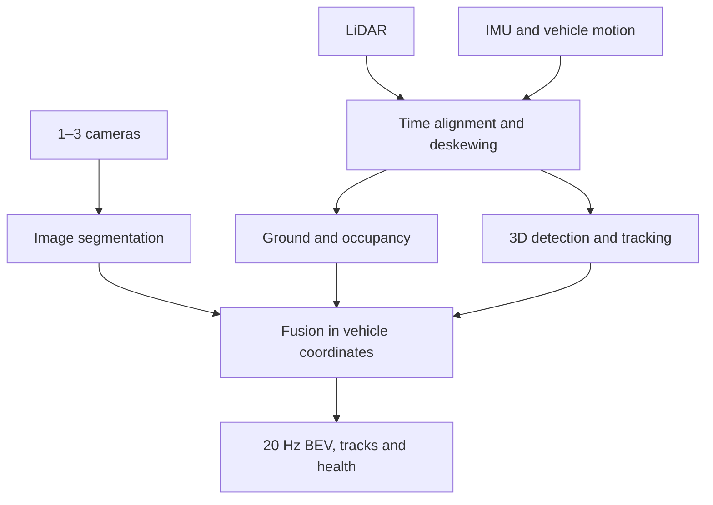

# Local BEV Perception with Cameras and LiDAR

A development plan for a local bird’s-eye-view (BEV) perception system using **1–3 front cameras with approximately 43° field of view and a LiDAR**, targeting **20 Hz output** for on-road evaluation.

**Recommended approach:** use LiDAR to estimate ground, obstacles, and free space; use cameras to add semantic labels; combine both in vehicle coordinates. Deploy through ROS 2, C++, and TensorRT.

> Status: architecture and implementation plan. No software pipeline or measured performance is included. The specifications below are initial engineering targets, not demonstrated product capabilities.

## 1. Goal and scope

Build a rolling local map ahead of the vehicle that answers:

- Where is the ground, and how does its height change?
- Which cells are occupied, free, or unknown?
- What do observed surfaces represent: road, sidewalk, vehicle, pedestrian, cyclist, or other?
- Where are moving objects, and how fast are they moving?
- How old and reliable is each observation?

The initial representation is **2.5D**: a top-down grid with height information. It is not a full volumetric 3D occupancy model.

Assumptions:

- LiDAR remains installed and active while driving.
- “Small area” means a local region around the front of the vehicle.
- Camera FOV is assumed to be horizontal; confirm against the actual lens and operating resolution.
- Vehicle motion is available through an IMU and wheel odometry or LiDAR odometry.
- Initial on-road evaluation runs in shadow mode: record and display perception without having the vehicle controller depend on it.

## 2. Initial output specification

| Item | Proposed setting |
|---|---|
| Forward range | 0–40 m |
| Lateral range | 15 m left and right |
| Cell resolution | 0.20 m |
| Grid dimensions | 200 forward × 150 lateral cells |
| Output rate | 20 Hz, one update every 50 ms |
| Geometry | Ground height, obstacle height, occupied/free/unknown |
| Semantics | Road, sidewalk, vehicle, pedestrian, cyclist, other |
| Object tracks | Position, dimensions, velocity, class, confidence |
| Reliability | Observation age, coverage, confidence, sensor/calibration health |

A 20 cm cell size describes map discretization; it does not guarantee 20 cm measurement accuracy. Confirm that the range is sufficient for the intended speed and stopping distance.

## 3. Camera arrangement

Start with one camera and LiDAR. Add outward-facing cameras after the baseline is calibrated and stable.

| Camera count | Suggested yaw directions | Approximate combined horizontal FOV |
|---|---|---:|
| 1 | 0° | 43° |
| 2 | −15°, +15° | 73° |
| 3 | −30°, 0°, +30° | 103° |

These estimates assume nearly colocated cameras and approximately 13° overlap between adjacent views. Mounting offsets, lens distortion, cropping, and vehicle obstruction change actual coverage.

A single 43° camera covers approximately 3.9 m of width at 5 m ahead. Near-side regions therefore have limited camera coverage. Camera height and vertical FOV also determine the nearest visible road surface.

## 4. System architecture

### Suggested components

| Function | Starting point | Required work |
|---|---|---|
| Runtime | ROS 2 and C++ | Sensor drivers, timestamp handling, bounded queues, diagnostics |
| Ground and occupancy | Autoware components | Adapt to LiDAR, mounting, slopes, and local map dimensions |
| Image segmentation | PIDNet-S | Validate labels, adapt training data, export to TensorRT |
| LiDAR object detection | CUDA-PointPillars | Validate or retrain for the sensor and operating region |
| Semantic fusion | Custom C++/CUDA component | Projection, visibility checks, confidence and temporal updates |
| Replay and visualization | Recorded sensor logs and RViz 2 | Inspect geometry, labels, tracks, age, and failure states |

Component names are evaluation candidates. Verify platform compatibility, dependency versions, and licenses before integration. Pin validated versions for reproducible builds.

## 5. Calibration and synchronization

### Required calibration

1. Measure each camera’s intrinsics and distortion at its operating resolution.
2. Estimate camera-to-LiDAR extrinsics.
3. Estimate LiDAR-to-vehicle extrinsics.
4. Establish the IMU and odometry frame relationships.
5. Validate independently at near, middle, and far distances and near image edges.

Use OpenCV for camera calibration and evaluate Direct Visual LiDAR Calibration for camera–LiDAR alignment. A checkerboard calibration alone does not automatically establish camera-to-vehicle alignment.

### Coordinate conventions

- Define the vehicle frame consistently, for example `base_link`: x forward, y left, z up.
- Use a camera optical frame with x right, y down, z forward where required by the driver.
- Record transform direction explicitly. For example, `T_camera_from_lidar` converts LiDAR-frame points to the camera optical frame.
- Transform all map observations to the vehicle frame at a defined reference timestamp.
- Keep calibration files versioned with sensor serial numbers, resolution, lens settings, and mounting configuration.

### Timing requirements

Prefer hardware triggering or a supported clock synchronization mechanism. Confirm the actual camera, LiDAR, interface, and computer support before selecting the mechanism.

Record exposure timestamps, LiDAR point timestamps, and motion timestamps against a common time basis. Pairing nearby ROS message arrival times does not synchronize independent sensor clocks.

At 15 m/s, a 20 ms offset corresponds to 0.30 m of ego-vehicle travel. Moving objects introduce additional misalignment.

**Deskewing** corrects LiDAR points for vehicle movement during scan acquisition. It requires per-point timing and an appropriate motion estimate. Validate time alignment with moving sequences, not only parked scenes.

## 6. LiDAR geometry and occupancy

Implement this baseline before adding camera semantics:

1. Remove points belonging to the vehicle body.
2. Deskew the scan using motion estimates.
3. Estimate local ground height, allowing for slopes.
4. Extract obstacles above the local ground.
5. Ray-trace measurements to update free, occupied, and unknown cells.
6. Maintain a rolling map using vehicle motion.
7. Decay stale evidence and expose observation age.

**No points does not mean free space.** A cell may be occluded, outside sensor coverage, or unobserved.

Maintain separate treatment for static evidence and moving objects. Use tracking and expiration rules to prevent moving objects from leaving persistent ghost obstacles.

## 7. Camera semantics and fusion

For each camera:

1. Run a segmentation network at an initial inference resolution such as 640 × 384, preserving aspect ratio through resizing or padding.
2. Update the effective intrinsics and pixel mapping to match preprocessing.
3. Align LiDAR observations to the camera exposure time using the available motion estimate.
4. Transform points into the camera optical frame and project them into the image.
5. Reject points behind the camera, outside the image, or hidden behind nearer surfaces.
6. Associate visible points with semantic probabilities.
7. Fuse labels into BEV cells with confidence and observation age.

Keep geometric obstacle evidence when camera labels disagree or are uncertain. Outside camera coverage, semantic labels remain unknown even when LiDAR provides geometry.

For dense road labels, project image observations onto the **estimated local ground surface**. A single flat-road homography becomes inaccurate on hills and bumps. Lane markings require appropriate labels or a dedicated lane head.

When overlapping cameras disagree, use visibility, confidence, and timing consistency rather than overwriting labels in arrival order.

## 8. 20 Hz performance plan

### Initial allocation

| Stage | Budget per update |
|---|---:|
| Input handling, preprocessing, deskewing | 5 ms |
| Ground and occupancy | 8 ms |
| Segmentation across all enabled cameras | 15 ms |
| LiDAR detection | 9 ms |
| Fusion, tracking, publication | 5 ms |
| Reserve | 8 ms |
| **Total** | **50 ms** |

These are allocation targets, not measurements. Parallel execution can change the critical path and introduce GPU contention; profile the complete deployed pipeline.

### Deployment practices

- Use TensorRT FP16 initially; evaluate INT8 only with representative calibration data and accuracy validation.
- Preallocate buffers and reuse memory.
- Minimize CPU–GPU transfers and image copies.
- Bound queues and define a stale-frame dropping policy.
- Measure camera batching versus separate inference on the target hardware.
- Record mean, p95, and p99 processing latency, dropped frames, queue depth, temperature, and power behavior.
- Measure sensor-to-output age separately from processing time and output frequency.
- Benchmark continuously under maximum input load and sustained thermal conditions.

### Output rate versus fresh measurements

A 10 Hz LiDAR cannot provide 20 new complete scans each second. A 20 Hz map can still update ego pose and predict object motion between scans, but must report the age of its underlying observations.

If 20 Hz fresh depth is required, select a LiDAR mode that supports it and validate its coverage and point density. Hardware synchronization does not increase scan rate.

## 9. Implementation roadmap

An integrated prototype may take roughly 8–12 weeks with compatible hardware and focused engineering effort. Product qualification needs additional validation; this is a planning estimate.

| Stage | Deliverable | Exit gate |
|---|---|---|
| 1. Sensor bring-up | Repeatable sensor recording and replay | Actual rates, timestamp offsets, and data loss measured |
| 2. Calibration | Sensors aligned with vehicle coordinates | Independent alignment checks across distances and motion |
| 3. LiDAR BEV | Ground, obstacles, free and unknown space | Correct obstacle placement and occlusion behavior |
| 4. Camera fusion | Semantic BEV | Labels stay aligned during turns and object movement |
| 5. Detection and tracking | Dynamic object tracks | Tracks and stale-obstacle removal validated |
| 6. Optimization | Full 20 Hz output pipeline | Sustained latency and freshness targets met under load |
| 7. Road evaluation | Shadow-mode logs and scenario results | Agreed accuracy, coverage, and failure-handling criteria met |

Suggested first milestone: **one camera + LiDAR + motion estimate → calibrated recording/replay → LiDAR-only BEV → camera labels**.

## 10. Product validation

Define numerical acceptance thresholds before collecting the qualification dataset. Set thresholds by distance, speed, obstacle size, and operating conditions; no universal threshold is assumed here.

| Area | What to measure |
|---|---|
| Obstacle detection | Misses by object size, class, and distance |
| Free space | False-free cells, especially behind occluders |
| Ground estimation | Height errors on slopes, bumps, and uneven roads |
| Semantic fusion | Road boundary and label alignment errors |
| Tracking | Position/velocity error, identity changes, ghost persistence |
| Timing | Output frequency, p95/p99 latency, observation age |
| Robustness | Glare, darkness, rain, blockage, dropout, mounting changes |
| Runtime | Sustained thermal performance, memory use, restart behavior |

Sensor failures must appear in diagnostics and output validity. Affected map regions should lose confidence or become unknown when evidence becomes unreliable. Define maximum observation age and track expiration explicitly.

Use held-out recordings for evaluation, including moving pedestrians, crossing vehicles, intersections, slopes, and regions outside camera coverage. Keep training, tuning, and acceptance datasets separate.

## 11. Suggested repository organization

The following is a proposed structure; these components have not been implemented:

| Path | Purpose |
|---|---|
| `README.md` | Architecture, assumptions, and development gates |
| `config/sensors/` | Sensor modes and driver configuration |
| `config/calibration/` | Intrinsics, extrinsics, timestamps, and metadata |
| `config/perception/` | Grid, model, fusion, and tracking settings |
| `src/sensor_bridge/` | Sensor transport and timestamp normalization |
| `src/pointcloud_processing/` | Self-filtering, deskewing, ground estimation |
| `src/image_segmentation/` | Preprocessing and TensorRT execution |
| `src/bev_fusion/` | Occupancy and semantic integration |
| `src/object_tracking/` | Object association and motion prediction |
| `src/diagnostics/` | Timing, sensor health, and validity |
| `launch/` | Live and replay launch configurations |
| `tools/` | Calibration checks, export, and profiling |
| `evaluation/` | Scenario definitions and acceptance reports |

Keep large logs, datasets, and generated engines outside source control. Record model provenance and the hardware/software versions used to build each engine.

## 12. Hardware decisions still required

- [ ] Onboard computer/GPU, power mode, and software platform.
- [ ] Exact LiDAR model, scan mode, point density, and timing capabilities.
- [ ] Camera model, interface, resolution, shutter type, frame rate, and synchronization support.
- [ ] Confirmation that 43° is horizontal FOV at the operating resolution.
- [ ] IMU and vehicle-motion source.
- [ ] Required map range and maximum driving speed.
- [ ] Required distinction between 20 Hz publication and 20 Hz fresh depth.
- [ ] Environmental, enclosure, power, and mounting requirements.

## 13. Optional later phase: learned BEV fusion

Evaluate BEVFusion after the geometric baseline works. Adapting a pretrained system to 1–3 narrow cameras and a different LiDAR requires dataset, calibration, model, and deployment work.

Compare against the baseline using the same sensor recordings, accuracy metrics, complete-system latency, and observation freshness. Published model throughput on another sensor configuration is not a guarantee for this system.

## 14. Reference starting points

These resources were identified in the original plan; confirm current documentation and compatibility during implementation.

- [OpenCV camera calibration](https://docs.opencv.org/4.x/dc/dbb/tutorial_py_calibration.html)
- [Direct Visual LiDAR Calibration](https://github.com/koide3/direct_visual_lidar_calibration)
- [Autoware distortion corrector](https://autowarefoundation.github.io/autoware_universe/main/sensing/autoware_pointcloud_preprocessor/docs/distortion-corrector/)
- [Autoware point-cloud occupancy grid](https://autowarefoundation.github.io/autoware_universe/main/perception/autoware_probabilistic_occupancy_grid_map/pointcloud-based-occupancy-grid-map/)
- [PIDNet](https://github.com/XuJiacong/PIDNet)
- [NVIDIA CUDA-PointPillars](https://github.com/NVIDIA-AI-IOT/CUDA-PointPillars)
- [NVIDIA CUDA-BEVFusion](https://github.com/NVIDIA-AI-IOT/Lidar_AI_Solution/tree/master/CUDA-BEVFusion)
