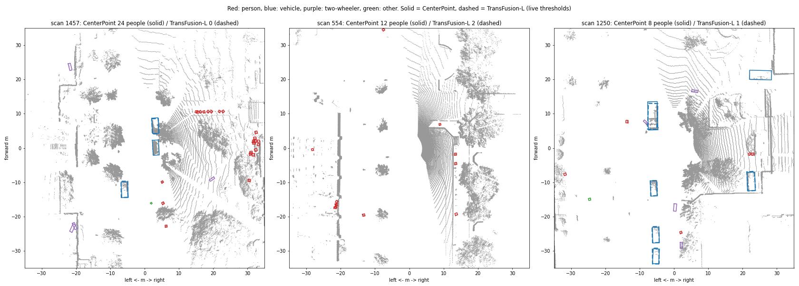

# LiDAR 3D detector comparison: CenterPoint vs TransFusion-L vs BEVFusion-L

Analysis of 2026-11-25, Jetson AGX Thor, offline on a recorded drive. No labelled ground truth exists for
this rig; every conclusion below rests on consistency proxies, cross-model agreement, motion on the map and
a visual check, and is stated with that limit.

## Summary

- **TransFusion-L and BEVFusion-L are the same network** (MIT: "the LiDAR-only baseline is TransFusion-L");
  the two independently trained checkpoints behave almost identically on this drive.
- **Both are far steadier than the live CenterPoint-PointPillar**: 82 % of their boxes reappear in the previous
  and next scan (CenterPoint 56 %), 5 % flicker (21 %), vehicle position jitter 0.06 m (0.125 m), heading
  jitter 1.0 deg (2.4 deg).
- **CenterPoint's extra objects are mostly false alarms**, especially people and two-wheelers: 71 % of its
  long-lived "people" never move, they sit in rows along fences and walls, and only 7 % are confirmed by
  TransFusion-L. TransFusion-L's people move (9 % static) and 64 % are confirmed by CenterPoint.
- **For vehicles both agree**: 91 % of TransFusion-L vehicles are also found by CenterPoint; CenterPoint finds
  more distant vehicles (2.9 vs 1.8 per scan beyond 35 m), of which only part are confirmed.
- **TransFusion-L is 5x slower**: about 200 ms per scan in PyTorch FP32 (CenterPoint 41 ms in TensorRT FP16),
  so it cannot replace the live 17-20 Hz detector as it is.

**Recommendation:** keep CenterPoint live for now, but raise its person and two-wheeler thresholds (or require
motion / persistence downstream) to cut the static false people; pursue a faster TransFusion-L (FP16,
compiled, GPU voxelization, or TensorRT sparse convolution) as the more reliable detector, and confirm the
false-alarm finding against camera images or a small labelled set before acting on it for safety.

## Models

| | CenterPoint-PointPillar (live) | TransFusion-L | BEVFusion-L |
| --- | --- | --- | --- |
| Weights | OpenPCDet `cbgs_dyn_pp_centerpoint` | OpenPCDet model zoo | MIT BEVFusion `lidar-only-det.pth` |
| Backbone | 2D pillars, 0.2 m | 3D sparse voxels, 0.075 x 0.075 x 0.2 m | same as TransFusion-L |
| Head | CenterPoint heatmap, 6 heads | transformer, 200 queries | same |
| nuScenes val mAP / NDS (published) | pillar CenterPoint, lower | 64.58 / 69.43 | 64.68 / 69.28 |
| Range | +-51.2 m | +-54 m | +-54 m |
| Runtime here | C++ TensorRT FP16 | PyTorch FP32 + spconv | PyTorch FP32 + spconv |

All three are trained on nuScenes (32-beam LiDAR, 10 classes) and see Ouster OS-1-128 data here: a domain
shift for all of them. Setup details (spconv build for CUDA 13 / compute 11.0, MIT weight conversion) are in
[lidar_transfusion.md](lidar_transfusion.md).

## Data and method

- **Drive:** `bags/camera_lidar_20261010T221427_088256Z`, dense 2048x10 mode, 18-186 s, **1,680 scans**
  (1,671 with poses), urban campus loop with parked cars, traffic, pedestrians, fences, trees.
- **Input, identical for all three:** 3 sweeps merged in the newest scan's frame with FAST-LIO poses
  (<= 0.35 s span), nuScenes time-lag feature, reflectivity as intensity (0-255), the measured self-mask.
- **Thresholds:** the live per-class thresholds (car / person 0.30, motorcycle / bicycle 0.35, truck / cone 0.40,
  bus 0.45, trailer / construction vehicle / barrier 0.50), plus uniform 0.30 and 0.50 as a sensitivity check.
- **Groups:** vehicle (car, truck, bus, trailer, construction vehicle), person, two-wheeler (motorcycle,
  bicycle), static (barrier, traffic cone).
- **Measures** ([analyze_sweep_eval.py](../tools/analyze_sweep_eval.py),
  [compare_detector_runs.py](../tools/compare_detector_runs.py)); boxes are placed on the map with each
  scan's pose:
  - *persistent*: a box of the same group within the gate (vehicle 2 m, two-wheeler 1.5 m, person / static
    1 m) in both the previous and the next scan; *isolated*: in neither (flicker);
  - *jitter*: scan-to-scan change of matched vehicle position and heading;
  - *confirmed by the other model*: a box of the same group from the other detector within the gate in the
    same scan;
  - *static long tracks*: boxes chained through >= 10 consecutive scans (~1 s); share that moved < 0.5 m.

## Results

### Overall (live thresholds)

| | CenterPoint | TransFusion-L | BEVFusion-L |
| --- | --- | --- | --- |
| Boxes per scan | 15.4 | 5.8 | 5.6 |
| Persistent | 55.8 % | **82.5 %** | 81.7 % |
| Isolated (flicker) | 21.2 % | **4.9 %** | 5.2 % |
| Vehicle position jitter, median | 0.125 m | **0.059 m** | 0.064 m |
| Vehicle heading jitter, median | 2.42 deg | 1.03 deg | **0.92 deg** |
| Vehicle score, median | 0.55 | 0.60 | 0.60 |
| Vehicles beyond 30 m per scan | **3.9** | 2.4 | 2.4 |

### Per object group

| Group | Detector | Per scan | Persistent | Isolated | Confirmed by the other model | Long tracks that never move |
| --- | --- | --- | --- | --- | --- | --- |
| Vehicle | CenterPoint | 6.52 | 77 % | 9 % | 64 % | 49 % (171) |
| | TransFusion-L | 4.22 | **85 %** | **4 %** | **91 %** | 74 % (122) |
| Person | CenterPoint | 4.08 | 32 % | 34 % | **7 %** | **71 % (55)** |
| | TransFusion-L | 0.37 | 54 % | 19 % | 64 % | 9 % (11) |
| Two-wheeler | CenterPoint | 2.28 | 27 % | 38 % | **2 %** | 79 % (33) |
| | TransFusion-L | 0.04 | 46 % | 25 % | 83 % | (2 tracks) |
| Barrier / cone | CenterPoint | 2.49 | 66 % | 16 % | 40 % | 91 % (56) |
| | TransFusion-L | 1.12 | **84 %** | **5 %** | **89 %** | 96 % (23) |

"Confirmed" for CenterPoint means by TransFusion-L and vice versa. Many vehicles are parked, so static vehicle
tracks are expected; static barriers and cones are correct.

### By distance (boxes per scan)

| Group | Detector | 0-20 m | 20-35 m | 35-55 m |
| --- | --- | --- | --- | --- |
| Vehicle | CenterPoint | 1.36 | 1.88 | 2.88 |
| | TransFusion-L | 1.00 | 1.20 | 1.76 |
| Person | CenterPoint | 0.62 | 1.87 | 1.50 |
| | TransFusion-L | 0.05 | 0.21 | 0.11 |
| Two-wheeler | CenterPoint | 0.57 | 0.89 | 0.78 |
| | TransFusion-L | 0.01 | 0.02 | 0.01 |
| Barrier / cone | CenterPoint | 1.41 | 0.79 | 0.29 |
| | TransFusion-L | 0.75 | 0.33 | 0.04 |

CenterPoint's surplus of people and two-wheelers grows with distance (where points are sparse and posts,
bushes and poles look alike); TransFusion-L's vehicle count drops past 35 m.

### Threshold sensitivity

| Threshold | Detector | Boxes per scan | Persistent | Isolated | Vehicle jitter |
| --- | --- | --- | --- | --- | --- |
| uniform 0.30 | CenterPoint | 21.8 | 53.1 % | 22.9 % | 0.141 m |
| | TransFusion-L | 6.6 | 82.9 % | 5.0 % | 0.060 m |
| uniform 0.50 | CenterPoint | 7.3 | 63.3 % | 15.7 % | 0.101 m |
| | TransFusion-L | 4.2 | 81.1 % | 6.0 % | 0.050 m |

Raising CenterPoint to 0.50 removes most of its surplus but it still flickers three times as much as
TransFusion-L at 0.30, and its vehicle jitter stays twice as large: the gap is not only a threshold choice.

### Visual check



On the scans where CenterPoint reports the most people (24, 12 and 8), most of its people (red) sit in
regular rows along a fence at 10 m and along building walls, where TransFusion-L reports none; both find the
same cars (blue).

### TransFusion-L vs BEVFusion-L

| | TransFusion-L (OpenPCDet) | BEVFusion-L (MIT) |
| --- | --- | --- |
| Vehicles per scan / confirmed by the other | 4.22 / 90 % | 4.14 / 92 % |
| People per scan / confirmed by the other | 0.37 / 48 % | 0.23 / 78 % |
| Persistent / isolated | 82.5 % / 4.9 % | 81.7 % / 5.2 % |

On 60 scans, matched boxes agree within 0.07 m (position), 0.25 m (length), 0.01 m (width), 7 deg (heading),
same class 96 %. There is no practical reason to prefer one checkpoint; BEVFusion-L is slightly more
conservative on people.

### Speed (median per scan, 3 sweeps, about 500,000 points)

| | CenterPoint | TransFusion-L | BEVFusion-L |
| --- | --- | --- | --- |
| Total | **40.8 ms** (p95 45 ms) | 199.8 ms (p95 233 ms) | 192.4 ms (p95 215 ms) |
| Sweep merge + voxelize / pillars | 16.6 ms | 79.3 ms (Python merge, GPU voxelize) | 78.0 ms |
| Network | 23.4 ms (TensorRT FP16) | 120.5 ms (PyTorch FP32) | 113.9 ms |
| Voxels / pillars | 48,904 pillars | 191,942 voxels (cap raised to 400,000) | 160,000 (default cap, full) |

## Limitations

- **No ground truth.** Persistence, cross-model agreement and motion are proxies. A real pedestrian standing
  still for over a second counts as a "static person"; a false alarm that repeats on the same pole counts as
  persistent. The visual check covers three scans.
- **One drive**, one place, one weather; 10 Hz dense mode, while the live car runs 1024x20 (20 Hz, fewer
  points per scan).
- **Domain shift** for every model (nuScenes 32-beam -> Ouster 128-beam, intensity scale); nothing was retrained.
- **TransFusion-L may under-detect** distant vehicles and some people; fewer boxes is not proof of higher recall
  quality.
- The MIT voxel cap stayed at 160,000 (filled on every scan); raising it for the OpenPCDet run changed counts
  by under 3 %.

## Recommendations

1. **Now, live:** raise CenterPoint's person threshold (e.g. 0.30 -> 0.45) and two-wheeler thresholds, and let
   the tracker / planner ignore people that never move and never get support; measure the effect with the
   same tools.
2. **Confirm** the false-alarm finding: project the boxes of the three scans above (and a random sample) into
   the camera images of the same bag, or label ~100 frames.
3. **Speed up TransFusion-L** before any live trial: FP16 and `torch.compile`, GPU sweep merging, then a
   TensorRT engine with sparse convolution (NVIDIA Lidar_AI_Solution) or a lower-rate second detector beside
   CenterPoint.
4. **Re-run on a 1024x20 recording** of the live configuration.

## Reproduce

```bash
cd /home/agxthor/SingleCameraBev/camera_lidar_bev
source /opt/ros/jazzy/setup.bash && source install/setup.bash
/usr/bin/python3 tools/extract_lidar_sweeps.py bags/camera_lidar_20261010T221427_088256Z \
    maps/local_gps_recording_002/trajectory.csv data/sweeps_20261010 --start 18 --end 186
install/bev_lidar_detection/lib/bev_lidar_detection/centerpoint_sweep_eval \
    models/lidar_objects_002/centerpoint_pillar_fp16.plan data/sweeps_20261010 data/transfusion_eval/centerpoint_s3.jsonl 3 0.35
../.venv/bin/python tools/transfusion_lidar.py data/sweeps_20261010 data/transfusion_eval/transfusion_openpcdet_s3_v400k.jsonl \
    --weights openpcdet --max-voxels 400000
../.venv/bin/python tools/transfusion_lidar.py data/sweeps_20261010 data/transfusion_eval/transfusion_mit_s3.jsonl --weights mit
/usr/bin/python3 tools/analyze_sweep_eval.py data/sweeps_20261010 data/transfusion_eval/centerpoint_s3.jsonl \
    data/transfusion_eval/transfusion_openpcdet_s3_v400k.jsonl data/transfusion_eval/transfusion_mit_s3.jsonl
/usr/bin/python3 tools/compare_detector_runs.py data/sweeps_20261010 centerpoint=data/transfusion_eval/centerpoint_s3.jsonl \
    transfusion_openpcdet=data/transfusion_eval/transfusion_openpcdet_s3_v400k.jsonl --out evaluation/detector_comparison_cp_vs_tf_001.json
```

Outputs: [transfusion_vs_centerpoint_001.txt](../evaluation/transfusion_vs_centerpoint_001.txt),
[detector_comparison_cp_vs_tf_001.json](../evaluation/detector_comparison_cp_vs_tf_001.json),
[detector_comparison_tf_vs_mit_001.json](../evaluation/detector_comparison_tf_vs_mit_001.json).
Code at commit `da7b1b56` plus the uncommitted TransFusion tools.
