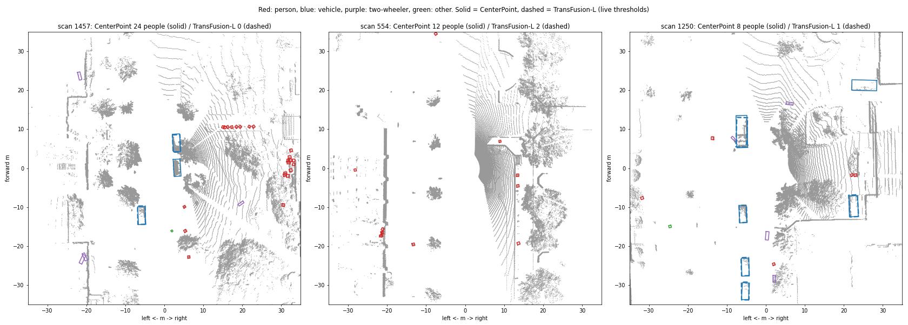

# TransFusion-L / BEVFusion-L on the Thor (offline comparison)

**TransFusion-L** and **BEVFusion-L** (BEVFusion's LiDAR-only model) are the same network: a sparse 3D
voxel backbone (0.075 m voxels, `VoxelResBackBone8x`), a 2D BEV backbone and a transformer detection head
with 200 object queries, trained on nuScenes (10 classes, +-54 m). MIT's BEVFusion README states that its
LiDAR-only baseline is TransFusion-L. Two independently trained checkpoints are compared here with the
live detector, CenterPoint-PointPillar:

| Weights | Source | nuScenes val mAP / NDS (published) |
| --- | --- | --- |
| `transfusion_lidar_nuscenes.pth` (`--weights openpcdet`) | OpenPCDet model zoo | 64.58 / 69.43 |
| `bevfusion_lidar_only_det.pth` (`--weights mit`) | MIT BEVFusion release | 64.68 / 69.28 |
| CenterPoint-PointPillar (live) | OpenPCDet model zoo | lower: pillar model |

Both files live in `models/lidar_objects_003/` (not in git). **This is an offline comparison**: nothing
here runs on the live car yet.

## What it took on the Thor (compute 11.0, CUDA 13, PyTorch 2.13)

The sparse backbone needs **spconv**, which has no build for this GPU. It is built from source in
`third_party/cumm` and `third_party/spconv` (git-ignored), installed editable into `.venv`:

1. cumm (git, 0.8.2): add `"11.0"` to `supported_arches` and `((13, 0), (12, 0))` to the CUDA-version table
   in `cumm/common.py`; switch its `"c++14"` defaults to `"c++17"` (CUDA 13's libcu++ requires C++17).
2. Build with `CUMM_CUDA_VERSION=13.0 CUMM_CUDA_ARCH_LIST="11.0+PTX" CUMM_DISABLE_JIT=1` / `SPCONV_DISABLE_JIT=1`
   and `ninja` on `PATH`; spconv 2.3.8 is installed with `--no-deps` (it pins cumm < 0.8).
3. Run with `SPCONV_DISABLE_JIT=1 CUMM_DISABLE_JIT=1` (the runner sets them): otherwise both libraries try
   to recompile themselves at import, which fails.

[`tools/transfusion_lidar.py`](../tools/transfusion_lidar.py) builds the network from the vendored OpenPCDet
source without OpenPCDet's compiled training ops (stubbed; not used at inference), converts the old spconv
weight layout `(k, k, k, in, out)` to spconv 2 `(out, k, k, k, in)`, and for the MIT weights:

- reverses the spatial axes of every 3D kernel (MIT voxels are `(x, y, z)`, OpenPCDet `(z, y, x)`) and
  transposes every 2D kernel (MIT's BEV map is `(x, y)`, OpenPCDet `(y, x)`);
- converts its boxes from the older mmdet3d convention (`(w, l, h)`, `yaw' = -yaw - pi/2`).

Check of the conversion (60 scans): MIT and OpenPCDet boxes with score >= 0.3 match within 0.07 m (median),
length 0.25 m, width 0.01 m, heading 7 degrees, same class 96 %.

## Run the comparison

```bash
cd /home/agxthor/SingleCameraBev/camera_lidar_bev
source /opt/ros/jazzy/setup.bash && source install/setup.bash
/usr/bin/python3 tools/extract_lidar_sweeps.py bags/camera_lidar_20261010T221427_088256Z \
    maps/local_gps_recording_002/trajectory.csv data/sweeps_20261010 --start 18 --end 186
install/bev_lidar_detection/lib/bev_lidar_detection/centerpoint_sweep_eval \
    models/lidar_objects_002/centerpoint_pillar_fp16.plan data/sweeps_20261010 data/transfusion_eval/centerpoint_s3.jsonl 3 0.35
../.venv/bin/python tools/transfusion_lidar.py data/sweeps_20261010 data/transfusion_eval/transfusion_openpcdet_s3.jsonl --weights openpcdet
../.venv/bin/python tools/transfusion_lidar.py data/sweeps_20261010 data/transfusion_eval/transfusion_mit_s3.jsonl --weights mit
/usr/bin/python3 tools/analyze_sweep_eval.py data/sweeps_20261010 data/transfusion_eval/*.jsonl
```

Same input for all three: the 2026-10-10 dense drive (2048x10, 1,680 scans, 18-186 s), 3 sweeps merged
with FAST-LIO poses within 0.35 s, the same self-mask. There is no ground truth, so the analysis uses
consistency proxies (a real object reappears at about the same map position in the next scan; false
alarms flicker), at the live per-class thresholds and at uniform 0.30 / 0.50.

## Results (2026-11-25, 1,680 scans, 3 sweeps, live per-class thresholds)

| | CenterPoint-PointPillar (live) | TransFusion-L (OpenPCDet) | BEVFusion-L (MIT) |
| --- | --- | --- | --- |
| Boxes per scan | 15.4 | 5.8 | 5.6 |
| Box seen in previous and next scan | 55.8 % | **82.5 %** | 81.7 % |
| Isolated (flicker) | 21.2 % | **4.9 %** | 5.2 % |
| Vehicle position jitter, median | 0.125 m | **0.059 m** | 0.064 m |
| Vehicle heading jitter, median | 2.4 deg | **1.0 deg** | 0.9 deg |
| Cars per scan | 4.7 | 3.8 | 3.8 |
| People per scan | 4.1 | 0.4 | 0.2 |
| Motorcycles + bicycles per scan | 2.3 | 0.04 | 0.05 |
| Vehicles beyond 30 m per scan | 3.9 | 2.4 | 2.4 |
| Time per scan, median | **41 ms** (TensorRT FP16) | 200 ms (PyTorch FP32) | 192 ms |

Full tables (also at uniform 0.30 and 0.50): [transfusion_vs_centerpoint_001.txt](../evaluation/transfusion_vs_centerpoint_001.txt).
TransFusion runs use `--max-voxels 400000` (OpenPCDet) and the nuScenes default 160,000 (MIT); the dense
Ouster sweeps fill 160,000 voxels on every scan, but raising the cap (median 192,000 used) changed the counts
by under 3 %.



**Reading.** The two TransFusion-L checkpoints behave almost identically. Both are far steadier than
CenterPoint (a quarter of the flicker, half the position and heading jitter) and report far fewer objects,
above all people and two-wheelers. On the scans where CenterPoint finds the most people (above), most of
its people sit in regular rows along fences and building walls, where TransFusion reports none, and both
find the same cars: CenterPoint's extra people look largely like false alarms on posts and poles. This is
not ground truth: a camera check of those scans, or labelled frames, is needed before saying TransFusion
misses no real pedestrians. Range is shorter (+-54 m model limit; fewer distant vehicles).

**Cost.** In plain PyTorch, TransFusion-L takes about 200 ms per 3-sweep scan (about 80 ms of Python sweep
merging and voxelization, 120 ms on the GPU), 5x CenterPoint's TensorRT engine, so it cannot replace
the live detector at 17-20 Hz as is. Options: FP16 / `torch.compile`, moving sweep merging and voxelization
to the GPU, or NVIDIA's TensorRT sparse-convolution route (Lidar_AI_Solution); or run it at a lower rate
alongside CenterPoint.

The complete analysis (per class, by distance, cross-model agreement, motion, threshold sensitivity,
recommendations) is in [lidar_detector_comparison.md](lidar_detector_comparison.md).
