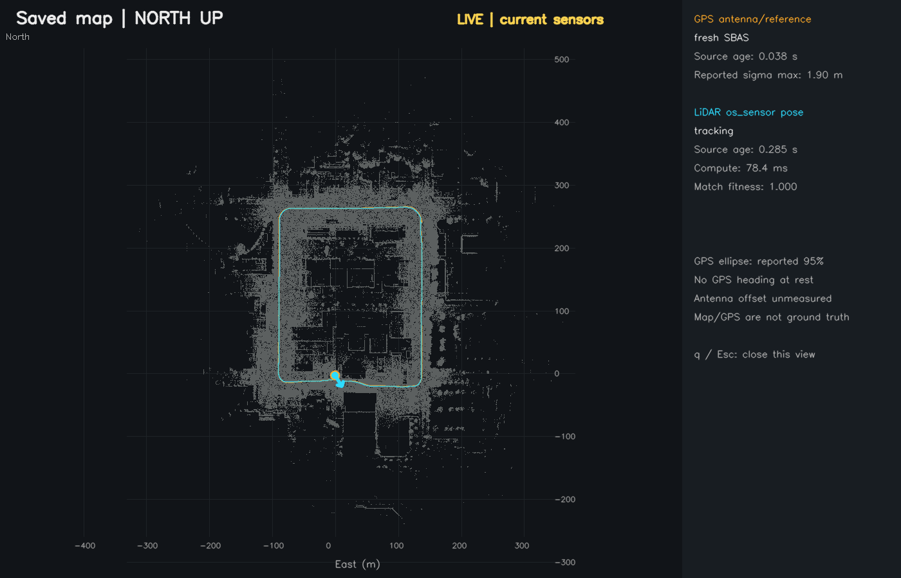
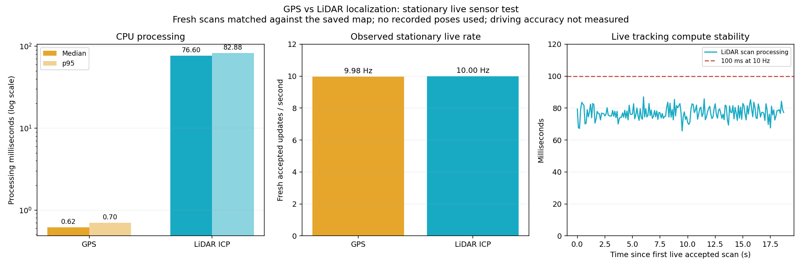

# Visual results

These results come from the project's front camera, Ouster OS1-128 and GPS receiver on NVIDIA AGX Thor. The images and GIF are included in the repository; recordings, full point-cloud maps and model engines remain local.

## Live camera, LiDAR and localized BEV


An actual live prototype view: yellow camera 2D labels, orange LiDAR 3D predictions and green camera/LiDAR associations, beside the flat **0–80 m forward, ±30 m lateral** BEV. The blue saved-map points and north-up inset use a live pose estimated by scan-to-map matching, without looking up recorded trajectory poses. Predicted dimensions and frame-local IDs appear in the object table.

This snapshot precedes the subsequent optimized [20-second coupled live check](../evaluation/localized_bev_live_001.json): **10 FPS**, map ready in **200/200 sampled frames**, localization processing **78.9 ms median / 90.9 ms p95**, and **0.250 s median pose source age** after registration. That timing check's final scene had no accepted camera matches; an earlier physical scene produced camera-matched world boxes. Neither result establishes detection or absolute positioning accuracy.

Run the live view on the configured rig:

```bash
bash tools/run_localized_bev.sh --map maps/local_gps_recording_002
```

See the [combined display guide](combined_bev_display.md#live-vehicle-and-objects-on-the-saved-map).

## Short recording replay


This is a short **1× replay** of the original camera/LiDAR recording with YOLO camera 2D labels, PointPillars LiDAR 3D predictions, LiDAR projections and the saved-map BEV. Its map position comes from the **original recording's saved trajectory poses**. It demonstrates the recorded display and detections; the separate live results above and below demonstrate independent scan-to-map localization.

Reproduce the recorded view with the local source bag and map:

```bash
bash tools/replay_combined_bev.sh --saved-map maps/local_gps_recording_002 \
  --rate 1 --no-road-lanes --max-points 30000 --range-m 80
```

## GPS versus LiDAR on a new drive



The **orange GPS** and **cyan LiDAR** traces were collected live on a new drive over the mapped area. The LiDAR localizer matched current scans against the frozen map, using GPS as a coarse position aid; it did not read the original trajectory poses.

The session accepted **3,117 poses over 312.9 seconds at 9.96 Hz**, with **77.1 ms median / 87.1 ms p95** processing. The two rejected attempts occurred during startup; the largest subsequent accepted-update gap was 0.200 s. This shows tracking continuity. GPS is not ground truth, and the receiver antenna offset and physical acquisition timing remain unverified. See the [localization guide](lidar_imu_mapping.md#compare-live-gps-with-lidar-localization) for session details.

## Stationary localization performance



This chart comes from a **separate stationary live run**, with approximately **10 Hz** updates for both methods. It is independent of the replay GIF and the coupled camera/BEV timing check.

| Processing stage | Median | p95 |
| --- | ---: | ---: |
| GPS position callback | 0.62 ms | 0.70 ms |
| LiDAR scan decoding and map registration | 76.6 ms | 82.9 ms |

These are CPU processing times, not equivalent inference tasks or end-to-end sensor latency. The LiDAR pose's median source age after publication was 0.277 s. Initialization and map preparation are excluded from the steady processing figures. See the [measurement report](../evaluation/localization_live_performance_001.json).

Object boxes, camera/LiDAR matches, reported GPS uncertainty and scan-registration residuals are diagnostic results rather than ground truth. Persistent object tracking and independent absolute accuracy evaluation remain future work.
