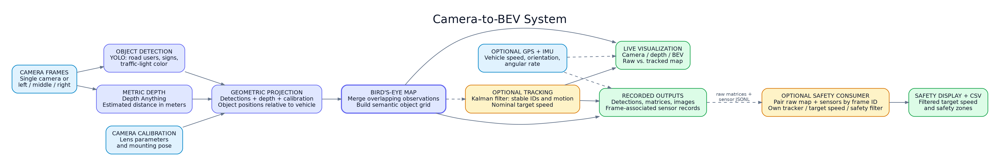
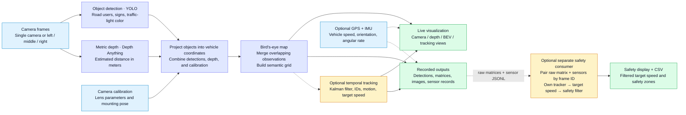

# Camera-to-BEV system overview

“We use cameras to detect road users and traffic signals, estimate their distance, and place them on a shared bird’s-eye map around the vehicle. An optional Kalman tracker stabilizes the map over time and estimates object motion and a target speed. We can display and record the results, and a separate optional consumer combines the recorded map with GPS and IMU data to evaluate a speed-safety limit.”

BEV means **bird’s-eye view**: a top-down representation of detected objects around the vehicle.

The two AI branches show data dependencies; they do not imply concurrent execution. Dashed arrows mark optional paths.

| Stage | What to tell an audience | Main implementation |
| --- | --- | --- |
| Camera input | Capture a single view or three views of the surroundings. | `bev_depth/io.py`, `bev_depth/multicam_infer.py` |
| Detection and depth | Identify objects and estimate how far away they are. Traffic-light color runs on the middle camera in the three-camera setup. | `bev_depth/detector.py`, `bev_depth/depth.py` |
| Geometry and fusion | Transform image observations into a common vehicle coordinate system, merge nearby duplicate detections, and create a top-down object map. | `bev_depth/geometry.py`, `bev_depth/multicam_infer.py`, `bev_depth/semantic_grid.py` |
| Temporal tracking | Keep object identities across frames, reduce flicker, estimate motion, and calculate a nominal target speed. | `bev_depth/temporal_tracking.py`, selected `bef-tracking-kf-*` directory |
| Display and recording | Show the scene and save results for inspection or downstream processing. | `bev_depth/render.py`, `bev_depth/sensors.py`, `runs/` |
| Optional safety consumer | Read matching map and sensor records, run its own tracker, and evaluate longitudinal safety zones and a filtered target speed. | `bef-tracking-kf-20hz-fixed/run_real_longitudinal_safety.py` |

Scope of this diagram:

- The current three-camera configuration uses left, middle, and right views. The single-camera entry point is `bev_depth.infer`; the fused entry point is `bev_depth.multicam_infer`.
- The three-camera semantic grid has shape **120 × 80**, at **1 meter per cell**: 80 meters forward, 40 meters rearward, and 40 meters to each side. Grid extent does not mean every cell is observed; empty cells are not proof of free space.
- Your tracking launch command selects `bef-tracking-kf-20hz-fixed` with a maximum update rate of 20 Hz. The code default remains `bef-tracking-kf-main` at 10 Hz. Actual updates depend on incoming frame timing.
- GPS and IMU are used for display and optional frame-associated logging in the camera producer. Its current tracker call does not pass GPS speed or IMU yaw directly. The separate safety consumer reads those inputs from `sensors/matrix_sensors.jsonl`, enabled in the producer with `--save-sensors`, alongside raw `matrix/*.npy` files.
- The safety consumer displays and logs its result; it does not issue vehicle actuation commands. LiDAR commands in the desktop notes launch a separate workspace and are outside this camera pipeline.
- Current depth defaults to Depth Anything V2 via TensorRT; the code also offers a Depth Anything 3 Metric engine override. Projection accuracy depends on depth quality and camera calibration.

For slides, use [the PNG](system_overview.png) or [the scalable SVG](system_overview.svg). The [Graphviz source](system_overview.dot) and Mermaid above are editable.
